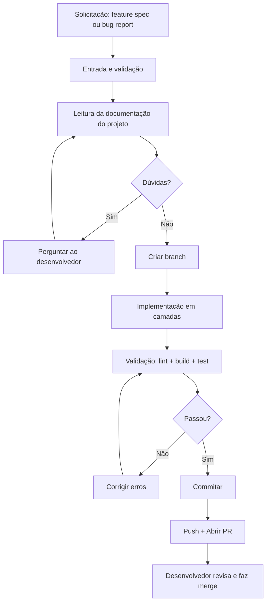

# Arquitetura do Agente



## Camadas do agente

### Core

Contém o contrato de comportamento (princípios obrigatórios, política
anti-achismo) e o procedimento operacional (fases sequenciais). Não conhece
framework específico — é genérico e reutilizável.

### Skills

Implementam conhecimento de domínio técnico. Cada skill é específica de um
framework ou ferramenta:

- `vue-vuetify-dev/` — padrões Vue 3, Vuetify, Composition API, Pinia, ofetch.
- `testing/` — estratégia de testes com Vitest e Playwright.

### Workflows

Procedimentos passo a passo acionáveis. Definem a sequência exata de ações
para cada tipo de tarefa:

- `create-feature.workflow.md` — do requisito ao PR.
- `fix-bug.workflow.md` — do bug report ao PR.
- `validate-code.workflow.md` — checklist de qualidade.

### Templates

Modelos de documentos que o desenvolvedor preenche e o agente consome:

- `feature-spec.md` — template de spec de feature.
- `adr.md` — template de ADR (registro de decisão arquitetural), copiado para
  `docs/decisions/` ao registrar uma decisão.

### Prompts

Comandos pré-formatados para iniciar o agente rapidamente:

- `create-feature.prompt.md` — ativa o workflow de feature.
- `fix-bug.prompt.md` — ativa o workflow de bug fix.

### Adapters

Traduzem o núcleo para o mecanismo de cada IDE. Ficam nos locais que cada
ferramenta reconhece automaticamente (`.kiro/`, `CLAUDE.md`, `.cursorrules`, etc.).
Referenciam `agent/` como fonte de verdade.

## Fluxo de dados

```text
Desenvolvedor → preenche spec em agent/templates/
     ↓
Agente (IDE) → lê adapter → lê core/CONTRACT → lê core/PROCEDURE
     ↓
Agente → lê skill (vue-vuetify-dev) → lê docs do projeto (ARCHITECTURE-GUIDE, READMEs)
     ↓
Agente → executa workflow (create-feature ou fix-bug)
     ↓
Agente → implementa → valida → registra ADR (se houver decisão arquitetural) → commita → abre PR
     ↓
Desenvolvedor → code review → merge
```

## Crescimento

Para adicionar suporte a outro framework (Angular, React, etc.):

1. Crie uma nova skill em `skills/<framework>/`.
2. Mantenha o mesmo contrato e procedimento do core.
3. Adicione apenas detectores e padrões específicos do framework.
4. Atualize os adapters se o mecanismo de ativação exigir.

Não copie a skill Vue para outro framework sem substituir as convenções.
