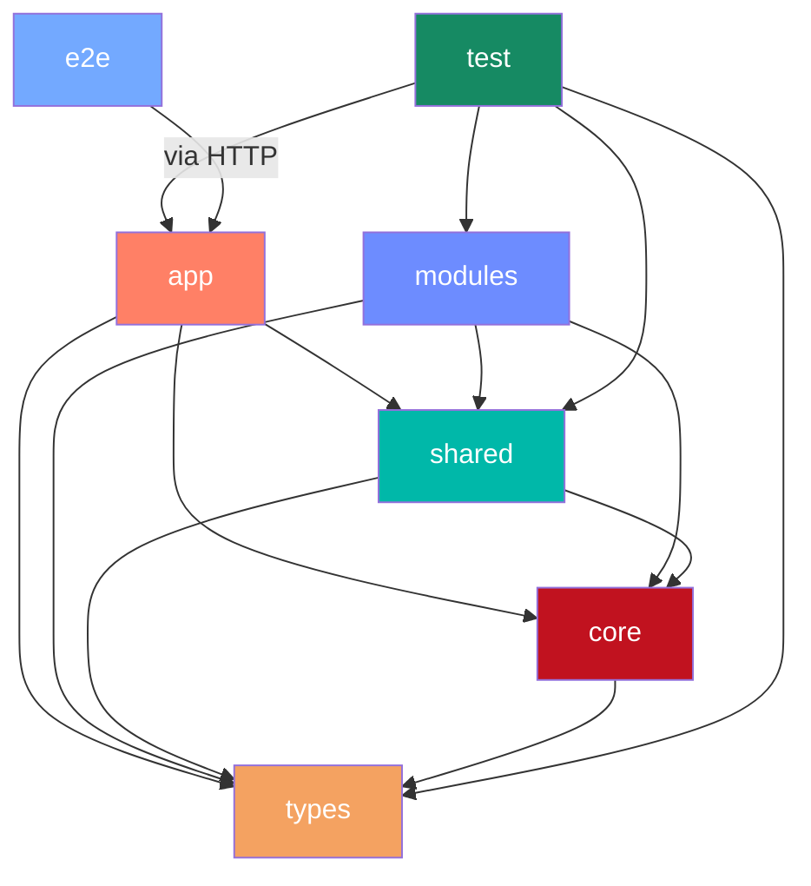
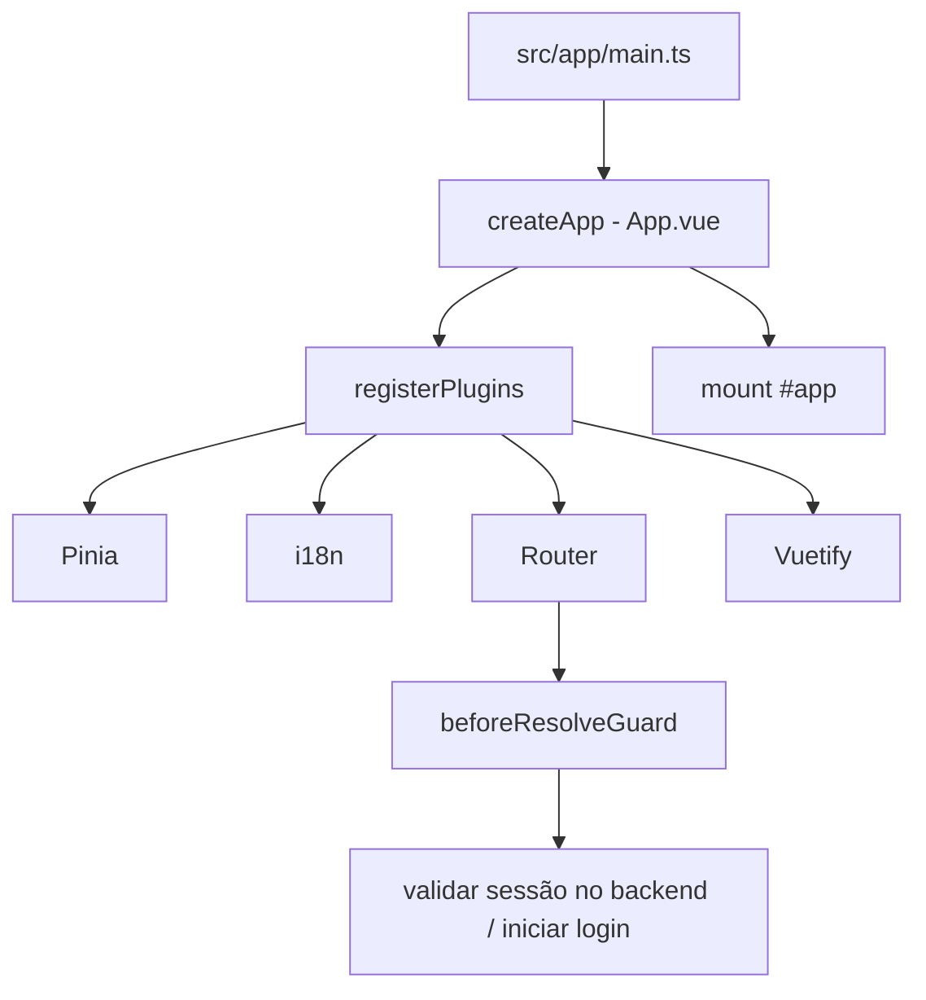
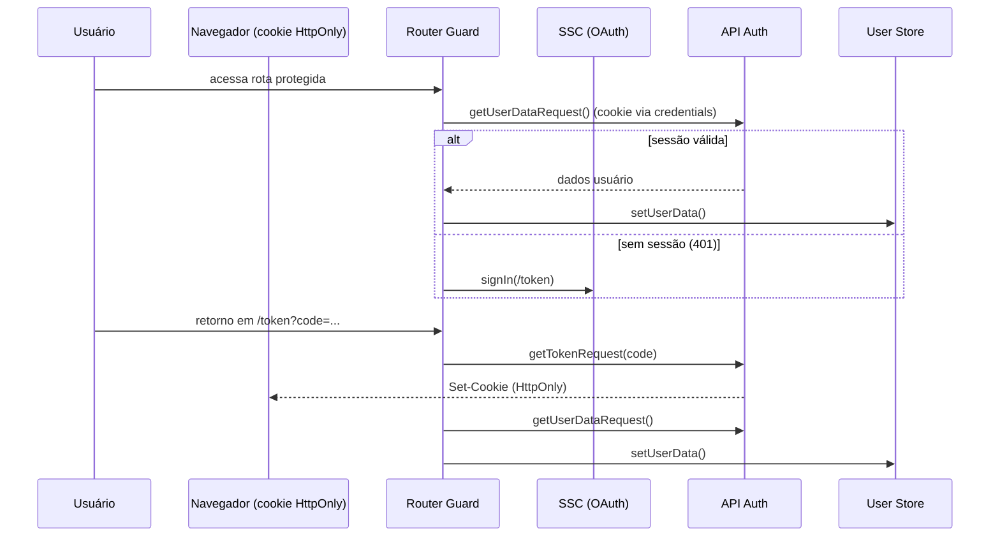

# Guia de Arquitetura Frontend

Documento central da arquitetura do projeto. Serve como ponto de entrada para
desenvolvedores e agentes de IA entenderem a estrutura, os padrões adotados e
onde implementar cada tipo de funcionalidade.

## Índice

- [Visão em camadas](#visão-em-camadas)
- [Diagrama de dependência](#diagrama-de-dependência)
- [Estrutura de pastas](#estrutura-de-pastas)
- [Mapa de documentação](#mapa-de-documentação)
- [Fluxo de inicialização](#fluxo-de-inicialização)
- [Fluxo de autenticação](#fluxo-de-autenticação)
- [Composição de rotas](#composição-de-rotas)
- [Camada HTTP](#camada-http)
- [Estado global](#estado-global)
- [Utils, Helpers e Composables](#utils-helpers-e-composables)
- [UI e Layouts](#ui-e-layouts)
- [Tipagem](#tipagem)
- [Testes](#testes)
- [Convenções gerais](#convenções-gerais)
- [Decisões arquiteturais (ADR)](#decisões-arquiteturais-adr)

---

## Visão em camadas

O código-fonte segue uma arquitetura em camadas com responsabilidades isoladas:

```text
app        → inicialização, providers, guard de auth e composição de rotas
modules    → funcionalidades por domínio (features)
shared     → infraestrutura transversal reutilizável
core       → base sem UI: config/env e cliente OAuth (state/nonce)
types      → contratos TypeScript centralizados por contexto
test       → validação automatizada (unitários e integração)
e2e        → testes end-to-end (Playwright)
```

Cada camada tem um contrato claro de dependência: camadas superiores podem
importar das inferiores, mas nunca o contrário. As regras são verificadas pelo
ESLint (`no-restricted-imports` em `eslint.config.mjs`) — ver ADR-0018.

---

## Diagrama de dependência



**Regras de dependência:**

| Camada  | Pode importar de             | Não pode importar de |
| ------- | ---------------------------- | -------------------- |
| app     | shared, core, types          | modules (*)          |
| modules | shared, core, types          | app, outro módulo    |
| shared  | core, types                  | app, modules         |
| core    | types                        | app, modules, shared |
| types   | nenhuma (apenas declarações) | qualquer outra       |

(*) Exceto o carregamento das rotas dos módulos via `import.meta.glob`.

Para inverter uma dependência que apontaria "para cima" (ex.: a camada HTTP
iniciar o login), a camada inferior expõe um ponto de registro e o `app`
injeta a implementação no bootstrap (ex.: `setUnauthorizedHandler(startLogin)`).
| test | todas as camadas de src | — |

---

## Estrutura de pastas

```text
.
├── docs/                          # Documentação arquitetural e guias
├── e2e/                           # Testes end-to-end (Playwright)
│   ├── *.spec.ts                  # Specs E2E (um arquivo por página/fluxo)
│   └── support/                   # Helpers compartilhados (ex.: mockUserSession)
├── public/                        # Assets estáticos servidos na raiz
├── src/
│   ├── app/                       # Bootstrap, providers, guard, rotas base
│   │   ├── locales/               # Mensagens i18n (pt-BR)
│   │   ├── providers/             # Registro de plugins (Pinia, i18n, Router, Vuetify)
│   │   ├── styles/                # SCSS global
│   │   └── views/                 # Views de uso global (token callback, erro, 404)
│   ├── core/                      # Base sem UI (não importa app/modules/shared)
│   │   ├── auth/                  # Cliente OAuth SSC e state/nonce
│   │   └── config/                # Constantes e variáveis de ambiente
│   ├── modules/                   # Features por domínio
│   │   ├── home/                  # Hub de documentação (público)
│   │   ├── architecture/ …        # Demais telas de documentação do template
│   │   └── protected-example/     # Exemplo de rota autenticada
│   ├── shared/                    # Infraestrutura transversal
│   │   ├── api/                   # Instâncias HTTP e services
│   │   ├── composables/           # Lógica reativa compartilhada (useXxx)
│   │   ├── helpers/               # Funções com efeito lateral (stores/services/sessão)
│   │   ├── stores/                # Estado global (Pinia)
│   │   ├── ui/                    # Layouts, componentes globais, ícones
│   │   ├── utils/                 # Funções puras (sem dependência de camadas)
│   │   └── assets/                # Arquivos estáticos compartilhados
│   ├── test/                      # Testes unitários e de integração (Vitest)
│   └── types/                     # Contratos TypeScript centralizados
├── .editorconfig                  # Configuração de editor (LF, UTF-8, 2 espaços)
├── .gitattributes                 # Normalização de line endings (eol=lf)
├── .prettierrc                    # Configuração do Prettier
├── playwright.config.ts           # Configuração do Playwright (webServer, Chromium)
├── eslint.config.mjs              # Configuração do ESLint (flat config)
├── tsconfig.app.json              # Configuração do TypeScript (paths, strict)
└── vite.config.ts                 # Configuração do Vite (aliases, build, test)
```

---

## Mapa de documentação

Cada pasta relevante possui um README local com regras, exemplos de bom e mau
código, e instruções de implementação. Navegue diretamente:

| Documento                                                 | Conteúdo                                     |
| --------------------------------------------------------- | -------------------------------------------- |
| [src/README.md](../src/README.md)                         | Visão geral do código-fonte                  |
| [src/app/README.md](../src/app/README.md)                 | Bootstrap, providers, guard                  |
| [src/core/README.md](../src/core/README.md)               | Config/env e cliente OAuth                   |
| [src/modules/README.md](../src/modules/README.md)         | Como criar um módulo de feature              |
| [src/shared/README.md](../src/shared/README.md)           | Utils, helpers, composables, stores, UI, API |
| [src/shared/api/README.md](../src/shared/api/README.md)   | Camada HTTP (factory, services)              |
| [src/types/README.md](../src/types/README.md)             | Tipagem e convenção de nomenclatura TS       |
| [src/test/README.md](../src/test/README.md)               | Estratégia de testes (Vitest + Playwright)   |
| [docs/ONBOARDING.md](ONBOARDING.md)                       | Guia: como criar uma feature passo a passo   |
| [docs/COMMIT-CONVENTIONS.md](COMMIT-CONVENTIONS.md)       | Padrão de mensagens de commit                |
| [docs/CODE-REVIEW-CHECKLIST.md](CODE-REVIEW-CHECKLIST.md) | Critérios de aprovação de PR                 |
| [docs/decisions/README.md](decisions/README.md)           | Decisões arquiteturais registradas (ADR)     |

---

## Fluxo de inicialização



1. `main.ts` cria a instância Vue com `App.vue`.
2. `registerPlugins` registra Pinia → handler de 401 → i18n → Router → Vuetify.
3. O Router carrega rotas automaticamente via `import.meta.glob('@/**/routes.ts')`.
4. `beforeResolveGuard` verifica autenticação antes de cada navegação.
5. A aplicação monta no elemento `#app`.

---

## Fluxo de autenticação

A autenticação usa OAuth SSC e está centralizada no guard do Router.



**Regras principais:**

- Rota `/token` recebe o `code` do SSC; o backend troca por tokens e emite o
  cookie de sessão via `Set-Cookie` (HttpOnly).
- O token não é acessível ao JavaScript; o navegador envia o cookie
  automaticamente (`credentials: 'include'`).
- Rota protegida: o guard valida a sessão pelo backend (dados do usuário);
  falha (ex.: 401) → redireciona para login SSC.
- O `code` só é trocado se o `state` conferir com o nonce gerado no `signIn`;
  sem nonce salvo (link de callback forjado), o retorno é rejeitado (ADR-0017).
- Falha na validação do `state` ou na troca do code → redireciona para
  `/erro-autenticacao?reason=<código>`; a tela traduz o código via i18n e nunca
  exibe texto livre vindo da URL.
- Erros das chamadas de `authBackend` são tratados pelo guard/logout, não pelo
  handler global de 401 da camada HTTP.
- O mock de autenticação (`VITE_AUTH_MOCK`) é desligado por padrão e proibido
  no modo `production`.
- O destino original é salvo em `sessionStorage` para redirect após login.

---

## Composição de rotas

O Router carrega automaticamente todos os `routes.ts` do projeto via glob:

```ts
const modules = import.meta.glob('@/**/routes.ts', { eager: true });
```

**Padrão esperado por módulo:**

```ts
import type { RouteRecordRaw } from 'vue-router';

const routes: RouteRecordRaw[] = [
  {
    path: '/clientes',
    name: 'Clientes',
    component: () => import('./views/ClientesView.vue'),
    meta: { requiresAuth: true },
  },
];

export default routes;
```

**Meta fields disponíveis:**

- `requiresAuth: true` → ativa guard de autenticação.
- `layout: 'empty'` → usa layout sem header/navegação.

---

## Camada HTTP

Padrão adotado: factory `createApiInstance` + services semânticos.

Documentação detalhada: [src/shared/api/README.md](../src/shared/api/README.md)

**Resumo:**

- `shared/api/instances/index.ts` → factory que recebe `baseURL`, cria **uma**
  instância do ofetch e retorna `get`, `post`, `put`, `patch`, `delete` e
  `download`, todos com `(url, { query?, body?, headers?, signal? })` e
  tipagem genérica, sem casts.
- Duas instâncias pré-configuradas: `httpClient` (API interna) e `authBackend`
  (sessão BFF: login, dados do usuário e logout). O SSC é acessado só por
  redirecionamento (`@core/auth`), nunca por chamada HTTP.
- Requisições usam `credentials: 'include'`: o cookie de sessão `HttpOnly` é
  enviado automaticamente (sem header `Authorization` manual — ver ADR-0014).
- Services em `shared/api/services/` expõem funções com nome de negócio.
- Componentes/views nunca chamam endpoints diretamente.

---

## Estado global

Stores Pinia ficam em `shared/stores/`. Cada store tem responsabilidade única.

| Store        | Responsabilidade                               |
| ------------ | ---------------------------------------------- |
| `app.store`  | Estado global de UX (tema persistido, loading) |
| `user.store` | Identidade e autorização do usuário            |

**Regra de uso:**

- Estado transversal/global → store.
- Estado local de tela/componente → `ref`/`reactive` no próprio componente.
- Lógica reativa derivada de stores → composables.

---

## Utils, Helpers e Composables

Documentação detalhada: [src/shared/README.md](../src/shared/README.md)

**Resumo da decisão:**

| Precisa de store/service? | É reativo (ref/computed)? | Vai para       |
| ------------------------- | ------------------------- | -------------- |
| Não                       | Não                       | `utils/`       |
| Sim                       | Não                       | `helpers/`     |
| Sim                       | Sim                       | `composables/` |

- **utils**: funções puras — `formatCurrency`, `truncate`, `formatDate`.
- **helpers**: interagem com stores/services — `cleanStorage`, `startLogin`, `endSession`.
- **composables**: lógica reativa — `useSession`, `useTheme`.

---

## UI e Layouts

- **Layouts** em `shared/ui/layouts/`: `DefaultLayout` (header + nav) e `EmptyLayout`.
- **Componentes base** em `shared/ui/components/`: agnósticos de domínio.
- `App.vue` seleciona o layout dinamicamente via `route.meta.layout`.

**Padrão de componente apresentacional:**

```vue
<script setup lang="ts">
defineProps<{ title: string; value: string }>();
const emit = defineEmits<{ select: [] }>();
</script>
```

**Convenções:**

- Views são containers (orquestram dados).
- Componentes filhos são apresentacionais (props + emits).
- Eventos customizados em camelCase (`switchTheme`, não `switch-theme`).

---

## Tipagem

Documentação detalhada: [src/types/README.md](../src/types/README.md)

**Resumo:**

- Centralizada em `src/types/` por contexto (auth, user, store, home, theme...).
- Alias de importação: `@typings/<contexto>`.
- Interfaces sem prefixo `I`, PascalCase, sem decoração de tipo no nome.
- Separar contrato de API do contrato de UI (mapear explicitamente).
- Preferir `interface` para objetos, `type` para uniões/utilitários.

---

## Testes

Documentação detalhada: [src/test/README.md](../src/test/README.md)

**Ferramentas:**

- **Unitários e integração**: Vitest + Vue Test Utils + happy-dom.
- **End-to-end**: Playwright (Chromium).

**Estrutura:**

- `src/test/` → specs unitárias (`.spec.ts`).
- `e2e/` → specs E2E (`.spec.ts`).

**Comandos:**

```bash
npm run test              # unitários (single run)
npm run test:watch        # unitários (watch mode)
npm run test:coverage     # cobertura
npm run test:e2e          # E2E headless
npm run test:e2e:open     # E2E interativo (Playwright UI)
npm run test:all          # unitários + E2E
```

**Thresholds de cobertura:**

Piso que só sobe (ratchet — ADR-0016), definido em `vite.config.ts`:
lines 45%, functions 29%, branches 57%, statements 43%.

---

## Convenções gerais

### Idioma

- **Documentação**: português (UTF-8, com acentuação).
- **Código** (nomes de funções, variáveis, arquivos): inglês.
- **Commits**: português.
- **Contratos de API**: mantém o idioma original do backend.

### Estilo de código

- Formatação 100% a cargo do Prettier (sem regras estilísticas no ESLint).
- ESLint cuida apenas de regras de qualidade e boas práticas.
- `editor.formatOnSave` habilitado no projeto (`.vscode/settings.json`).

### Aliases de importação

| Alias      | Aponta para    |
| ---------- | -------------- |
| `@`        | `src/`         |
| `@app`     | `src/app/`     |
| `@core`    | `src/core/`    |
| `@modules` | `src/modules/` |
| `@shared`  | `src/shared/`  |
| `@typings` | `src/types/`   |
| `@test`    | `src/test/`    |
| `@root`    | `./` (raiz)    |

**Regra**: sempre usar o alias mais próximo do destino. Nunca usar `@/shared/`
quando `@shared/` está disponível.

### Line endings

- Repositório normalizado em LF (`.gitattributes`).
- Editor configurado para salvar em LF (`.editorconfig`).

### Variáveis de ambiente

- Centralizadas em `src/core/config/index.ts` (`@core/config`).
- Nunca acessar `import.meta.env` diretamente fora do config.

---

## Decisões arquiteturais (ADR)

As decisões arquiteturais relevantes do projeto são registradas como
**ADR** (Architecture Decision Records) no formato MADR, em português, na pasta
[docs/decisions/](decisions/README.md).

Cada ADR documenta o contexto, as opções consideradas, a decisão tomada e suas
consequências — preservando o "porquê" das escolhas ao longo do tempo. As
decisões estruturais descritas neste guia (camadas, camada HTTP, autenticação,
roteamento, testes, tipagem, etc.) têm ADRs correspondentes.

Ao tomar uma nova decisão arquitetural, registre-a seguindo as instruções em
[docs/decisions/README.md](decisions/README.md).
